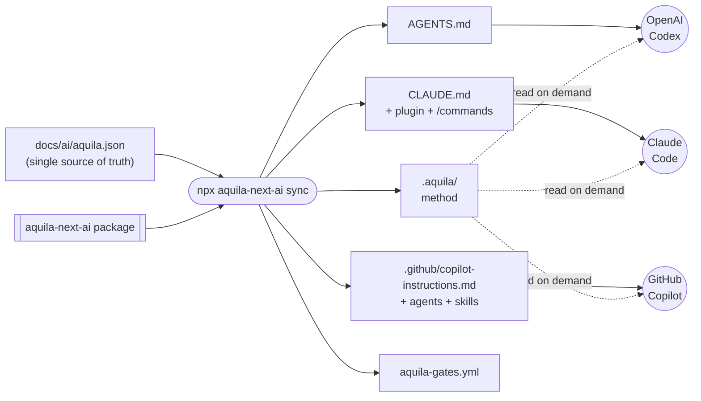
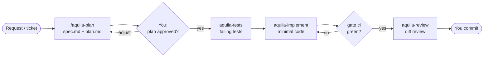
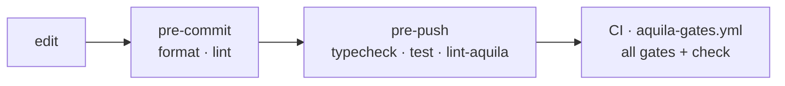
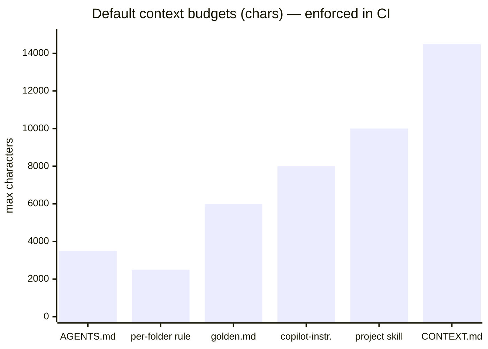

<p align="center">
  
</p>

<h1 align="center">aquila-next-ai</h1>

<p align="center">
  <b>Give your AI coding agents an eagle's eye.</b><br/>
  A battle-tested, spec-driven development method for <b>Next.js</b> — one install, the same discipline in
  <b>Claude Code</b>, <b>GitHub Copilot</b> and <b>OpenAI Codex</b>.
</p>

<p align="center">
  <a href="https://www.npmjs.com/package/aquila-next-ai"></a>
  
  
  
  
  
  <a href="LICENSE"></a>
</p>

---

Version **0.2.0**

## Why aquila-next-ai?

AI agents write code fast. Left alone, they also **skip tests, ignore your architecture, mix Pages and App
Router APIs, ship `"use client"` everywhere, use APIs that don't exist in your Next.js version, open 80-file PRs and burn through your token budget** re-reading the
whole repo.

aquila-next-ai turns any agent into a disciplined teammate:

| Without a method | With aquila-next-ai |
|---|---|
| The agent starts coding straight from a vague prompt | A **spec + 6-section plan**, then a hard stop until you say `plan approved` |
| Tests written after the fact (or never) | **TDD**: failing tests first, minimal code, gates green before "done" |
| Generic React that ignores Next.js idioms | **Official Next.js conventions**, version-aware (v12 → v16, focus on **15 and 16**): Server Components first, Server Actions, caching, a11y |
| Every tool configured differently | **One method** for Claude Code, Copilot and Codex, generated from one config |
| 2,000-line context files loaded on every prompt | **Token economy**: ≤ 3.5 KB always loaded, the rest read on demand |
| Huge PRs approved out of fatigue | **Small-PR directive**: above 30 files (configurable) the agent proposes incremental PRs |
| "Works on my machine" | **Gates** in git hooks and a generated GitHub Actions workflow |
| Docs that rot | **Doc-sync** checks: C4, ADRs and tracks updated in the same task |

## Install in 60 seconds

```bash
npm i -D aquila-next-ai
npx aquila-next-ai init
```

Then ask your agent for **`/aquila-init`**. It reads your codebase, confirms six choices with you and writes
the documentation the agents will rely on. That's it: `/aquila-plan` is ready.

## Sibling packages

The same method, one package per stack — they share the git hooks dispatcher, so they live side by side in
one repository (e.g. `backend/` + `frontend/`):

| Package | Stack |
|---|---|
| [`aquila-ai`](https://www.npmjs.com/package/aquila-ai) | NestJS (backend) |
| [`aquila-react-ai`](https://www.npmjs.com/package/aquila-react-ai) | React |
| [`aquila-next-ai`](https://www.npmjs.com/package/aquila-next-ai) | Next.js (this package) |

## What lands in your project

`init` scaffolds the full AI structure, versioned with your code so teammates **and cloud agents** get it
on clone:

```text
your-next-app/
├── .aquila/                         ← the method (rules, roles, skills, Next.js conventions) — synced from the package
│   ├── core/  skills/  agents/  adapters/  schema/  githooks/  .claude-plugin/
├── docs/
│   ├── ai/  CONTEXT.md · golden.md · aquila.json · skills/     ← what agents must know about YOUR project
│   ├── c4/  adr/  tracks/  reference/  runbooks/
├── .github/
│   ├── instructions/*.instructions.md                         ← per-folder rules (native in Copilot)
│   ├── copilot-instructions.md
│   └── workflows/aquila-gates.yml                             ← CI gates, generated
├── AGENTS.md  ·  CLAUDE.md                                    ← tiny routers every agent reads first
└── .claude/commands/aquila-*.md                               ← slash-command shortcuts
```

## One method, three agents



| | Claude Code | GitHub Copilot | OpenAI Codex |
|---|---|---|---|
| Entry point | `CLAUDE.md` → `AGENTS.md` | `copilot-instructions.md` + `AGENTS.md` | `AGENTS.md` |
| `/aquila-*` commands | ✅ plugin skills + shortcuts | ✅ `chat.agentSkillsLocations` | ✅ "aquila-plan …" |
| Roles (plan/tests/implement/review) | ✅ plugin agents | ✅ custom agents with handoffs | ✅ read as files |
| Per-folder rules | ✅ via the context map | ✅ native `.instructions.md` (also PR review) | ✅ via the context map |
| Guard against `--no-verify` / force push | ✅ PreToolUse hook | — (git hooks still apply) | — (git hooks still apply) |

## The methodology

### 1. Spec-Driven Development → Test-Driven Development



**Why it works for AI:** models are excellent at following a precise contract and poor at guessing intent.
The plan is that contract (scope, files, test strategy, docs to update), and the human checkpoint stops the
most expensive failure mode: confidently building the wrong thing. Failing tests first give the agent an
objective "done" signal instead of its own opinion.

### 2. Four specialised roles

| Role | Job | Never does |
|---|---|---|
| `aquila-plan` | Turns a request into a self-contained plan | Write production code |
| `aquila-tests` | Writes the failing tests from the plan's cases | Touch the implementation |
| `aquila-implement` | Minimal code to make tests pass, golden-file style | Expand scope |
| `aquila-review` | Ranked findings: correctness, layers, tests, docs, Next.js, PR size | Approve its own work |

Separating roles keeps each prompt small and focused, and the reviewer judges the diff, not the intent.

### 3. Next.js conventions, version-aware

Agents read the project's **installed Next.js major** (it's stamped into `AGENTS.md`) and router, and apply
[`core/nextjs.md`](core/nextjs.md): Server vs Client Components and where the `"use client"` boundary goes,
data fetching and caching, Server Actions with validation and authorization, Route Handlers, `next/image`/
`next/font`, accessibility and Core Web Vitals, env and security headers, testing with Testing Library and
Playwright. Version notes cover the changes that trip agents up — async `params`/`cookies()` and the caching
defaults flip in v15, `proxy.ts`, `"use cache"` and `next lint` removal in v16 — so the agent **never uses
an API newer than your project**.

### 4. Golden files and a context map

Instead of long style guides, `docs/ai/golden.md` points to one exemplary file per type (controller,
service, spec…). Agents copy proven patterns from **your** codebase. `docs/ai/CONTEXT.md` is a map: the
agent opens only the section a task needs, and **code always beats docs** when they disagree.

### 5. Quality gates, everywhere



Gates are detected from your `package.json` scripts (`typecheck`, `test`, `lint`, `format:check`,
`test:cov`, `build`, `test:e2e`) — no new tooling to learn. On top, **lint levels** (`off` / `standard` / `high`) add a
catalog of principles, each mapped to its Sonar rule and enforced with ESLint.

### 6. Token economy

What every agent loads on **every** prompt is capped; everything else is read on demand. These are the
default budgets `npx aquila-next-ai check` enforces (characters):



Before any task that reads the whole codebase, agents run `npx aquila-next-ai tokens` and **ask for approval**
when it would exceed 20 % of your monthly limit.

### 7. Small PRs by design

PRs above `review.prMaxFiles` changed files (**30** by default, set at `init`) get split: the plan proposes
increments, and the review flags oversized diffs with a concrete split (by layer, route segment or plan step).
Reviewable PRs mean real reviews — not rubber stamps.

## Commands

### Agent commands

Claude Code and Copilot: `/aquila-…` · Codex: "aquila-plan …".

| Command | What it does |
|---|---|
| `/aquila-init` | Sets up config, docs, CI, hooks and agents from the current state |
| `/aquila-plan` | Request → `spec.md` + `plan.md`, then stops for approval |
| `/aquila-execute` | Runs an approved plan: failing tests → code → gates → review |
| `/aquila-review` | Reviews a diff/PR (also code not written by the agent) |
| `/aquila-docs` | Generates/updates `CONTEXT.md`, golden files, per-folder rules, C4 |
| `/aquila-adr` · `/aquila-c4` · `/aquila-guideline` | Decisions, architecture diagrams, multi-ticket tracks |
| `/aquila-test-comment` | "How to test" steps for QA |
| `/aquila-audit` · `/aquila-deep-audit` | Method adoption audit · deep product audit (security, contracts, errors…) |
| `/aquila-config` · `/aquila-doctor` | Change settings · diagnose and fix the install |

### CLI

| Command | What it does |
|---|---|
| `npx aquila-next-ai init [flags]` | Install: config, templates, `.aquila/`, adapters, CI workflow, hooks |
| `npx aquila-next-ai sync` | Regenerate `.aquila/`, routers, settings and CI from `aquila.json` |
| `npx aquila-next-ai check [--ready]` | Schema, links, budgets, drift · strict local readiness |
| `npx aquila-next-ai gate <pre-commit\|pre-push\|ci>` | Run a phase's gates; prints only failures |
| `npx aquila-next-ai doctor` | Installation diagnostics |
| `npx aquila-next-ai lint [rules\|matrix]` | ESLint at the configured level · rule status |
| `npx aquila-next-ai tokens [paths…]` | Estimate tokens to read a scope |

`init` flags: `--lang=en|pt-BR|pt-PT` · `--tools=copilot,claude,codex` · `--token-limit=<n>|none` ·
`--mode=local|team` · `--lint=off|standard|high` · `--pr-max-files=<n>`.

### Claude Code plugin

```bash
claude plugin marketplace add ./.aquila
claude plugin install aquila@aquila-next-ai --scope local
```

(`--scope project` in team mode.) `npx aquila-next-ai doctor` reminds you if it's missing.

## `local` vs `team` mode

| | `local` | `team` |
|---|---|---|
| `.aquila/`, docs, config, CI | versioned | versioned |
| Routers (`AGENTS.md`, `CLAUDE.md`, Copilot) and settings | generated per machine | versioned — cloud agents and AI PR review get them |
| New teammate | `npm install && npx aquila-next-ai init` | same (hooks are per clone) |

## Monorepo / project in a subfolder

Run `init` **inside the project folder** (`repo/frontend`), where its `package.json` and
`node_modules` are. aquila-next-ai detects that the git root is above it and adapts:

| | Project at the repo root | Project in a subfolder / several aquila projects |
|---|---|---|
| Git hooks | `core.hooksPath = .aquila/githooks` | one dispatcher at the root: `core.hooksPath = .aquila-hooks` |
| Which gates run | this project's | each registered project's, **only if its folder changed** in the commit/push |
| CI workflow | `.github/workflows/aquila-gates.yml` | `<root>/.github/workflows/aquila-gates-<folder>.yml` with `paths: ['<folder>/**']` and `working-directory: <folder>` |
| `.git/info/exclude` (mode `local`) | `/AGENTS.md`… | `/<folder>/AGENTS.md`… |

The dispatcher is shared by the [sibling packages](#sibling-packages): `aquila-ai` in `backend/` and
`aquila-next-ai` in `frontend/` register in the same `.aquila-hooks/projects` file and never compete for
`core.hooksPath`. A project at the root that already had `.aquila/githooks` joins the dispatcher when a
second project runs `init`. The dispatcher is per clone (excluded from git): every dev runs `init` in each
project, as usual.

```text
repo/
├── .aquila-hooks/            ← pre-commit · pre-push (dispatcher, sh) · projects
│   └── projects              ← "backend<TAB>aquila-ai" · "frontend<TAB>aquila-next-ai"
├── .github/workflows/
│   ├── aquila-gates-backend.yml
│   └── aquila-gates-frontend.yml
├── backend/   (NestJS · aquila-ai)
└── frontend/  (Next.js · aquila-next-ai)
```

`npx aquila-next-ai doctor` shows the subfolder, the dispatcher and the projects sharing it;
`npx aquila-next-ai check` fails when the hooks or the workflow sit where git or GitHub never run them
(e.g. a 0.1.0 install in a subfolder — run `init` again to fix it).

## Updating

```bash
npm i -D aquila-next-ai@latest
npx aquila-next-ai sync
npx aquila-next-ai check
```

`sync` refreshes `.aquila/`; review and commit the diff. CI fails if `.aquila/` drifts from the installed
version, so the team always runs the same method.

## Requirements and limits

Node ≥ 22, Git, a Next.js project. Zero runtime dependencies. aquila-next-ai guides and automates checks; it does
not guarantee defect-free code or that every model obeys every rule — that's why the human checkpoint and the
gates exist.

## Contributing

See [`AGENTS.md`](AGENTS.md) and [`core/contributing.md`](core/contributing.md). Tests: `npm test`.
Releases: push a `vX.Y.Z` tag matching `package.json` and `.claude-plugin/plugin.json`; the release workflow
publishes to npm.

## License

[MIT](LICENSE) © Aquila Zimbrao
